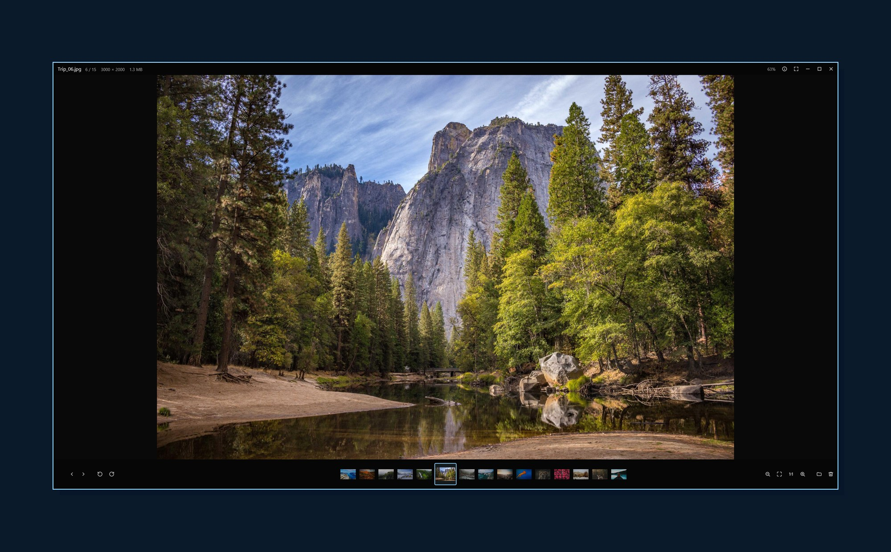

<p align="center">
  <picture>
    <source media="(prefers-color-scheme: dark)" srcset="assets/brand/header-dark.svg">
    
  </picture>
</p>

<p align="center">
  A fast, no-nonsense photo viewer for Windows, macOS and Linux.
</p>

<p align="center">
  <a href="https://github.com/Nominy/vitreus/releases/latest"></a>
  <a href="https://github.com/Nominy/vitreus/actions/workflows/ci.yml"></a>
  
  <a href="LICENSE"></a>
</p>

<p align="center">
  <a href="https://nominy.github.io/vitreus">Website</a> ·
  <a href="#install">Install</a> ·
  <a href="#usage">Usage</a> ·
  <a href="https://github.com/Nominy/vitreus/releases">Releases</a>
</p>

<p align="center">
  
</p>

Double-click a photo and Vitreus opens it over your dimmed desktop, with the rest
of the folder in a film strip underneath. Hold <kbd>→</kbd> to fly through
hundreds of photos. Click the background or press <kbd>Esc</kbd> and it's gone.
No library, no import, no account: just a viewer, in the spirit of Picasa Photo Viewer.

## Features

- **Instant.** Opens in a blink and shows each JPEG's embedded preview within
  milliseconds while the full decode runs in the background.
- **Fly-through.** Neighbouring photos are decoded ahead of you, so holding an
  arrow key glides through a folder.
- **Sharp at every zoom.** Screen-sized decode for viewing, full resolution the
  moment you zoom past it; zoom pauses at *fit* and *100%*.
- **Every format you shoot.** JPEG, HEIC, AVIF, JPEG XL, camera RAW, PSD, PNG,
  animated GIF/WebP/APNG, TIFF, SVG and [more](#formats).
- **Hands off your files.** Rotation is view-only, delete goes to the trash, and
  nothing is uploaded or tracked.
- **Native everywhere.** One GPU-accelerated Rust binary per platform, built on
  [GPUI](https://gpui.rs).

## Install

**macOS and Linux**

```sh
curl -fsSL https://nominy.github.io/vitreus/install | sh
```

**Windows** (PowerShell)

```powershell
irm https://nominy.github.io/vitreus/install.ps1 | iex
```

The installer downloads the latest release, verifies its checksum, installs it
for your user (no admin or sudo) and registers Vitreus as a photo viewer. On
macOS and Linux it becomes the default viewer straight away; Windows doesn't
let apps do that silently, so the installer opens **Settings → Default apps**
on Vitreus for you to click *Set default*.

**Package managers**

```powershell
scoop bucket add nominy https://github.com/Nominy/scoop-bucket
scoop install nominy/vitreus          # Windows
```

```sh
brew install --cask nominy/tap/vitreus   # macOS
```

Both register Vitreus as a photo viewer, and each release updates them.

<details>
<summary>Options, uninstall and manual download</summary>

macOS / Linux, options go after `sh -s --`:

| Option | |
|--|--|
| `--version <tag>` | install a specific release |
| `--no-default` | don't make Vitreus the default viewer |
| `--system` | Linux: install for all users under `/usr/local` (sudo) |
| `--source` | build from source with cargo instead of downloading |
| `--archive <file>` | install a release archive you already downloaded |
| `--uninstall` | remove Vitreus |

Windows, set environment variables before the one-liner (or pass the matching
parameters when running the script as a file):

```powershell
$env:VITREUS_VERSION = 'v0.1.0'   # -Version
$env:VITREUS_SCOPE = 'Machine'    # -Scope Machine: all users, from an elevated PowerShell
$env:VITREUS_NO_DEFAULT = '1'     # -NoDefault
```

Uninstall with `curl -fsSL https://nominy.github.io/vitreus/install | sh -s -- --uninstall`,
or on Windows via **Apps & features → Vitreus → Uninstall**.

Every [release](https://github.com/Nominy/vitreus/releases) also has the plain
archives, `SHA256SUMS` and both installers attached. On Windows, run
`vitreus --register` once to add an unzipped copy to "Open with" and Default Apps.

Linux needs xkbcommon, Wayland or X11, Vulkan and fontconfig, which desktop
installs already have; the installer names any missing package.
</details>

**Updates.** When it opens, Vitreus checks in the background (at most every six
hours) for a newer release. If there is one, a small notice in the title bar
offers **Update**, which reinstalls the same way you installed and reopens your
photo, or **Skip**, which stays quiet until the next version. The check fetches
one tiny file from GitHub and sends nothing about you; turn it off in Settings.

## Usage

```sh
vitreus photo.jpg     # or a folder; or just double-click a photo
```

| | Keys | Mouse |
|--|--|--|
| Next / previous | <kbd>→</kbd> <kbd>Space</kbd> / <kbd>←</kbd> <kbd>Backspace</kbd> | film strip, back/forward buttons, two-finger swipe |
| First / last | <kbd>Home</kbd> / <kbd>End</kbd> | |
| Zoom in / out | <kbd>↑</kbd> <kbd>=</kbd> / <kbd>↓</kbd> <kbd>-</kbd> | wheel (around the cursor) |
| Fit / actual pixels | <kbd>F</kbd> / <kbd>A</kbd> | double-click the photo |
| Pan | | drag the photo, anywhere, at any zoom |
| Rotate left / right | <kbd>L</kbd> / <kbd>R</kbd> | |
| Copy image | <kbd>Ctrl</kbd>+<kbd>C</kbd> | right-click menu |
| Show in folder | <kbd>W</kbd> | right-click menu |
| Move to trash | <kbd>Del</kbd> | right-click menu |
| Photo info (EXIF) | <kbd>I</kbd> | |
| Settings | <kbd>Ctrl</kbd>+<kbd>,</kbd> | sliders button |
| Full screen / hide bars | <kbd>F11</kbd> / <kbd>Tab</kbd> | |
| Open | <kbd>Ctrl</kbd>+<kbd>O</kbd> | drop a file on the window |
| Close | <kbd>Esc</kbd> | click the dimmed background |

On macOS <kbd>Ctrl</kbd> is <kbd>Cmd</kbd>.

### Settings

| | |
|--|--|
| **Scaling** | *Smooth* (bicubic, default), *Sharp* (Lanczos) or *Pixel perfect* (nearest neighbour: hard-edged pixels at any zoom, for pixel art and screenshots) |
| **Enlarge small photos to fit** | On by default; off shows small photos at their real size |
| **Check for updates** | The background release check above |

## Formats

- **Photos:** JPEG (EXIF orientation honoured), HEIC/HEIF, AVIF, JPEG XL, PNG and
  APNG, GIF and WebP (animated too), TIFF, BMP.
- **Camera RAW:** CR2, CR3, NEF, NRW, ARW, SRF, SR2, DNG, RAF, ORF, RW2, PEF, SRW,
  RAW, RWL, 3FR, IIQ, X3F. Vitreus shows the full-size JPEG the camera embeds in
  the file; it doesn't develop the raw sensor data.
- **Others:** Photoshop PSD/PSB (the flattened image), SVG, ICO, TGA, QOI, PNM,
  HDR, OpenEXR, DDS, farbfeld.

HEIC and AVIF use the system's decoder: on Windows the free *HEIF Image
Extensions*, *HEVC Video Extensions* and *AV1 Video Extension* from the Microsoft
Store (Vitreus tells you if one is missing), ImageIO on macOS and `libheif` on Linux.

## Building

You need [Rust](https://rustup.rs). On Linux also a C toolchain, `pkg-config`
and the development packages for xkbcommon, Wayland, Vulkan, xcb and fontconfig
(e.g. `libxkbcommon-x11-dev libwayland-dev libvulkan-dev libx11-xcb-dev libfontconfig1-dev`).

```sh
git clone https://github.com/Nominy/vitreus
cd vitreus
cargo run --release -- path/to/photo.jpg
```

`./install.sh --source` (macOS/Linux) or `.\install.ps1 -FromSource` (Windows)
builds and installs your checkout.

## Contributing

Issues and pull requests are welcome. Please run `cargo nextest run` before
sending a PR.

<details>
<summary>Project layout and releasing</summary>

| | |
|--|--|
| `src/viewer.rs` | the window: zoom/pan, film strip, bars, menus, settings panel |
| `src/loader.rs` | prioritized decode worker pool |
| `src/decode.rs`, `src/codecs/` | decoding, orientation, resizing; RAW, JPEG XL, PSD, HEIC/AVIF |
| `src/register.rs` | `vitreus --register`: Windows file-type registration |
| `src/update.rs` | update check and one-click update |
| `install.sh`, `install.ps1` | the installers |
| `scripts/` | release packaging and package-manager manifests |
| `site/` | the website at nominy.github.io/vitreus |

To release: bump `version` in `Cargo.toml`, commit, then
`git tag vX.Y.Z && git push --tags`. The *Release* workflow builds Windows x64,
macOS arm64/x64 and Linux x64/arm64 and publishes the release with checksums,
the installers and `latest.json` (read by the in-app update check). The *Pages*
workflow publishes `site/` and the installers.

Each release also updates the Scoop bucket (`Nominy/scoop-bucket`) and the
Homebrew tap (`Nominy/homebrew-tap`) through the `PACKAGES_TOKEN` secret, and
opens a winget pull request once a `WINGET_TOKEN` secret exists.
</details>

## Acknowledgements

Inspired by Google's Picasa Photo Viewer and [FlyPhotos](https://github.com/riyasy/FlyPhotos).
Built on [GPUI](https://gpui.rs), the UI framework behind [Zed](https://zed.dev).
Wordmark set in [Sora](https://fonts.google.com/specimen/Sora) (OFL). Screenshot
photo from [Unsplash](https://unsplash.com) via [Lorem Picsum](https://picsum.photos).

## License

[MIT](LICENSE)
